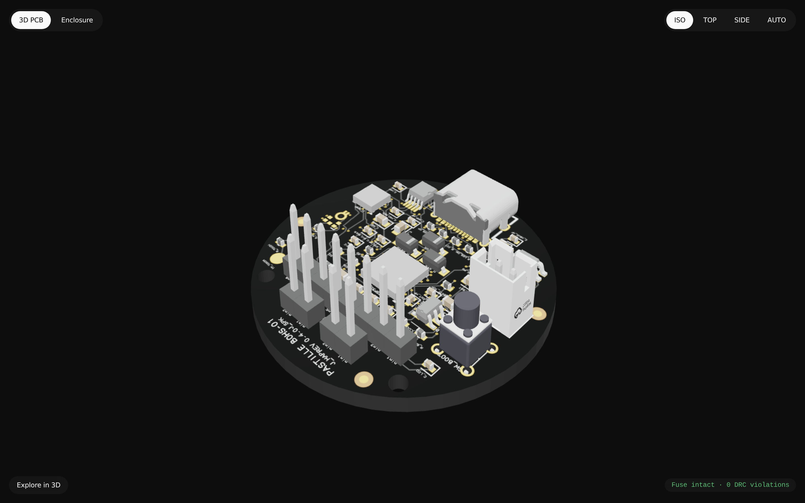
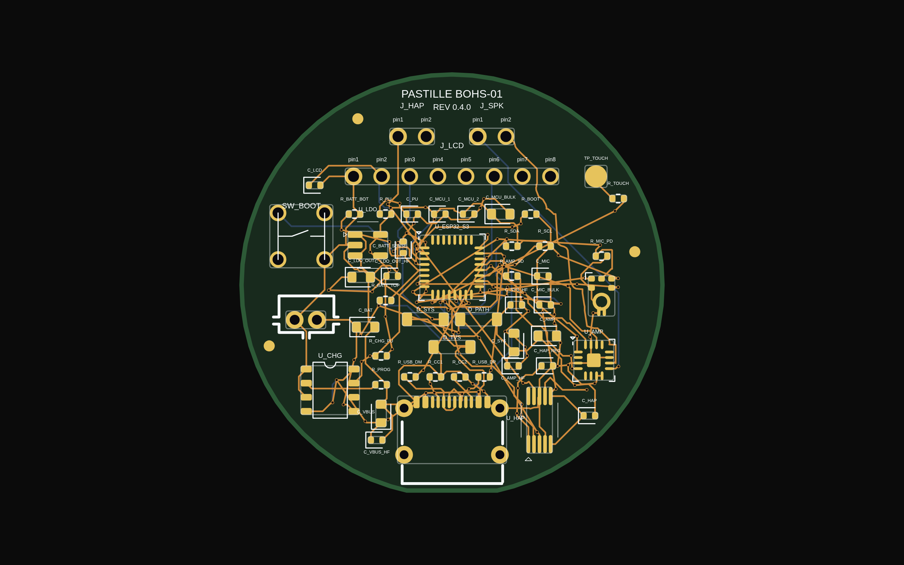
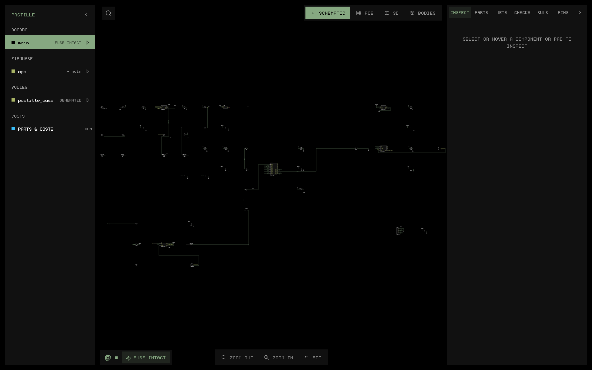

# Pastille

<p align="center">
  
</p>

Pastille is an open-source wearable AI charm and the reference hardware implementation of the Bulle Open Hardware Standard (BOHS-01).

It is a 42 mm disc, 14 mm thick, built around a 38 mm board. It clips to clothing or hangs as a pendant. Pastille captures your voice with a digital microphone and streams bidirectional audio to your private Bulle gateway. It talks over BLE 5.0 through the Bulle app when your phone or laptop is near, and over Wi-Fi straight to the gateway when it is not. It shows animated companion expressions on a round LCD and gives haptic feedback.

Pastille targets a BOM under $25 (about $21.80 at 1,000 units), a case that stays cool against your skin, a wake from deep sleep in under 50 ms, and about 80 days of deep sleep on one charge of its 120 mAh cell. These are design estimates, not measurements.

Live landing page and interactive 3D board viewer: https://pastille.facile.studio

## PCB and 3D hardware previews

### 3D PCB render



### 2D PCB layout



### Electronic schematic



## Specifications and standard

Pastille implements the complete BOHS-01 specification suite:

- [BOHS-01 Architecture Specification](docs/spec/BOHS-01-ARCH.md): System architecture, 38 mm physical geometry, thermal envelope under 40°C, $21.80 BOM, TP4056 charging, the current budget, transport selection, BLE pairing, and the 6-state power state machine.
- [BOHS-01 Wire Protocol Specification](docs/spec/BOHS-01-WIRE.md): The `bohs.v1` frame format over Wi-Fi WSS, BLE 5.0 GATT, and USB-C CDC, PCM16 16 kHz audio (opcode `0x01`), Reverse MCP edge tools (opcode `0x02`), and BLE provisioning (opcode `0x03`).
- [BOHS-01 Gateway Integration Guide](docs/spec/BOHS-01-GATEWAY.md): Bulle device claim and revocation, `bohs_tok_` device tokens, direct and app-relay sessions, Whisper.cpp ingestion, Piper TTS egress, and LLM edge tool calling.

## Connectivity and pairing

Pastille carries the same `bohs.v1` frames over three links:

- **BLE 5.0 relay.** Pastille talks to the Bulle mobile or desktop app over GATT service `b0010000-f4c1-4e00-b001-000000000001`. The app forwards frames to the gateway over its own WebSocket.
- **Wi-Fi direct.** Pastille connects to `wss://<gateway>/api/hardware/ws` with its `bohs_tok_` device token when no bonded phone or laptop is in range.
- **USB-C CDC.** Plugged into a computer running Bulle, Pastille sends frames over the USB serial port.

To pair, open the Bulle app and choose "Pair device". The app bonds over BLE and asks Pastille to identify itself. Pastille buzzes and shows a pairing ring. Tap the pad within 60 seconds. The app then claims the device, and sends it a device token and optional Wi-Fi credentials over the encrypted link.

## Architectural comparison

Standalone AI hardware often fails because designers build miniature smartphones running general-purpose operating systems like Android. BOHS-01 takes the opposite approach: dumb peripheral, intelligent gateway.

| Characteristic | Pastille (BOHS-01) | Muse Charm | OMI (Friend) | Rabbit R1 |
| :--- | :--- | :--- | :--- | :--- |
| Form factor | 42 mm disc, 14 mm thick | Screenless brooch | 40 mm circular pendant | Handheld rectangular slab |
| Target BOM cost | < $25 ($21.80) | ~ $18 | ~ $45 | ~ $199 retail |
| Display | 1.28-inch round IPS LCD (240x240) | None | None | 2.88-inch touchscreen |
| Battery life (standby) | About 82 days (55 uA deep sleep, estimate) | > 20 days | ~ 4 days | ~ 12 hours |
| Battery life (streaming) | About 1.3 h on BLE relay, 0.9 h on Wi-Fi direct (estimates) | > 12 hours | ~ 6 hours | ~ 4 hours |
| System architecture | Sensor / Actuator peripheral | Sensor peripheral | BLE audio streamer | Full Android OS (MediaTek MT6765) |
| Onboard operating system | None (Bare-metal Rust / Embassy) | None | None | Full Android AOSP fork |
| Boot / Wake latency | < 50 ms to wake, < 800 ms to audio | < 100 ms | Variable BLE pairing | > 45 seconds cold boot |
| Server protocol | Dual-transport `bohs.v1` (BLE 5.0 + Wi-Fi WSS) + Reverse MCP | WebSocket | BLE to smartphone app | Proprietary cloud bridge |
| Self-hostable | Yes (Local Bulle gateway) | Yes | Partial | No (Proprietary cloud only) |
| Privacy and data custody | Zero third-party telemetry | Zero third-party telemetry | Requires phone sync | Routes all traffic through cloud servers |
| Open hardware | Fully open (Fusible / KiCad) | Open | Partially open | Closed proprietary |

### Why dedicated operating systems fail on wearables

Devices like the Rabbit R1 and Humane Ai Pin placed a high-power mobile processor running Android inside a small enclosure. This creates structural flaws:

1. High quiescent power drain: Android kernels and background daemons consume tens of milliamperes even in standby. Pastille draws about 55 microamperes in deep sleep, display and board included.
2. Thermal throttling: Running a full operating system generates excess heat. Skin-contact electronics must stay below 40°C. Heavy processors quickly reach thermal limits and throttle performance.
3. Slow wake latency: Booting an operating system takes between 30 and 60 seconds. Pastille uses direct RTC wake interrupts that run application code in under 50 milliseconds.
4. Unnecessary bill of materials: Application processors, multirail PMICs, high-speed LPDDR4 memory, and eMMC flash storage drive BOM costs past $80 before assembly. Pastille uses a single ESP32-S3 module costing about $3.

Pastille treats the wearable as a low-latency remote sensor and display. Heavy speech recognition, language models, and tool integrations run on your home server, office workstation, or private cloud instance.

## Hardware development with Fusible

Pastille defines its printed circuit board programmatically using Fusible and tscircuit. You write board schematics, component placement, and net connections in TypeScript and React.

### Prerequisites

Install `bun`, Fusible 0.20.9 or later (`fusible --version`), and the project dependencies:

```bash
cd hardware
bun install
```

### Interactive development and DRC verification

Validate the electrical rules, strapping pins, decoupling capacitors, and generate typed Rust firmware pin bindings:

```bash
fusible check
```

Launch the Fusible Studio live preview server:

```bash
fusible dev
```

### Exporting manufacturing and CAD artifacts

Build the board kit and the enclosure bodies (`bodies/{front_bezel,lens,back_shell}.{step,stl}` and the reference parts), check that they fit, and export Gerbers, KiCad project files, STEP models and schematics:

```bash
fusible body kit main
fusible body
fusible assembly -f all
fusible export --preset all
bun hardware/fab/fab.ts
```

`fusible body` runs `hardware/bodies/build.ts`, which reads `bodies/kit/main/kit.json`. `fusible assembly` fails if any part collides. It writes `dist/assembly.glb` and `dist/assembly.step`.

`hardware/fab/fab.ts` finishes the fab files. Fusible 0.20.9 drops copper pours from its Gerbers, so the script writes the bottom ground pour from `dist/fab/circuit.json` into `B_Cu.gbr` as a G36 region and fails if it is missing. It also sets the drill files to 4 layers and writes `dist/fab/bom.csv` and `dist/fab/cpl.csv`.

To refresh the landing page models:

```bash
fusible export -f glb -o apps/web/static/models/pastille.glb
bun hardware/bodies/upright.ts apps/web/static/models/pastille.glb apps/web/static/models/pastille.glb
bun hardware/bodies/slim.ts dist/assembly.glb apps/web/static/models/pastille_assembly.glb
```

`upright.ts` turns the board half a turn about Y. Fusible writes the board with board +Y toward the front camera, so the silkscreen reads upside down in the viewer without it.

### Files for a board house

Send these files from a release, or from `dist/fab/` after the steps above:

| File | Use |
| :--- | :--- |
| `gerbers.zip` | Copper, mask, paste, silkscreen, outline and drill files for a 4-layer, 1.6 mm board, black mask, white silkscreen. The bottom layer carries the ground pour. |
| `bom.csv` | JLCPCB assembly BOM with LCSC part numbers. |
| `cpl.csv` | JLCPCB pick-and-place file, top side only. Check the rotations in the board house preview before you order. |

`J_SPK`, `J_HAP` and the test pads are bare pads, so they are not in the BOM or the CPL. The speaker, LRA, LCD panel and battery are bought separately (see `bom.yml`). `kicad.zip` holds the same board as a KiCad project, pour included, for anyone who wants to plot their own Gerbers.

The output files land in `dist/fab/`, `dist/cad/`, `dist/docs/`, and `bodies/`. See the enclosure section of [BOHS-01-ARCH.md](docs/spec/BOHS-01-ARCH.md) for the stack, the battery choice and the print guide.

The v0.4.0 case is an engineering prototype: it fits the 3D models, but no test print has checked it against the real panel and cell yet.

## Firmware guide

Pastille firmware runs bare-metal on the ESP32-S3 in Rust, on `esp-hal` 1.2 with the `esp-rtos` Embassy executor and `esp-radio` for Wi-Fi and BLE. Fusible generates the pin bindings in `apps/firmware/src/pins.rs`, and the device code takes every GPIO from there.

### What runs on the device in v0.4.0

- BLE peripheral (trouble-host on esp-radio): the BOHS-01 service with `B001` to `B004`, advertising with the service data, LE Secure Connections pairing with numeric comparison confirmed by a tap, and one bond kept in flash.
- BLE provisioning: `prov.identify`, the 60 s tap window bound to the connection, `prov.status`, `prov.configure`, `prov.state` notifications. The config is saved to the `pastille` flash partition and loaded at boot.
- Wi-Fi direct: station mode, DHCP, DNS, TLS 1.3 with pinned root CAs, and the `bohs.v1` WebSocket with the device token, reconnected with backoff. It runs when the config has `prefer_ble: false` and a Wi-Fi network.
- USB CDC transport on the USB Serial/JTAG port, with `u16be` stream framing.
- Reverse MCP over `0x02` on every transport: `tools/list`, `charm.display_avatar`, `charm.haptic_pulse`, `charm.get_telemetry`. Every request gets a result or a JSON-RPC error.
- The avatar, the pairing ring and the comparison code on the GC9A01 round LCD.
- Haptic pulses on the DRV2605L.
- Capacitive touch on the front pad through the ESP32-S3 touch sensor registers, calibrated at boot: taps authorize pairing and send `charm.tap_event`.
- Battery and charger sampling every 10 s, published to `charm.get_telemetry`, `B001` and `charm.low_battery`.
- Full-duplex audio: the SPH0645 microphone on I2S0 with DMA, VAD with a 300 ms hangover and upstream `0x01` frames during a session; the MAX98357A on I2S1 with DMA, an 80 ms jitter buffer, and `SD_MODE` shutting the amplifier down when idle.
- SNTP wall time over Wi-Fi; TLS checks certificate dates, and no Wi-Fi session opens before the clock is set.

Not in v0.4.0: the RSSI and temperature telemetry fields. None of the drivers has run on a board yet; host tests cover the protocol, framing, provisioning, storage records, touch thresholds, microphone sample conversion, VAD, jitter buffer, SNTP parsing, WebSocket handshake and the TLS chain check. The implementation status in [BOHS-01-WIRE.md](docs/spec/BOHS-01-WIRE.md) has the details, including the BLE audio throughput budget.

### Host unit tests

The host tests cover the wire protocol, stream framing, JSON-RPC error handling, Reverse MCP tools, BLE provisioning, the network routing, battery alerts, the power state machine and the avatar renderer:

```bash
mise run check-firmware
```

### Building and flashing

Install the ESP32 Rust toolchain and the flasher once:

```bash
cargo install espup --locked
espup install
cargo install espflash --locked
```

`espup` writes `~/export-esp.sh`. The firmware tasks source it and select the `esp` toolchain:

```bash
mise run build-firmware
```

`build-firmware` also writes `target/pastille-firmware.bin`, a 4 MB image with the partition table from `apps/firmware/partitions.csv`. The `pastille` data partition holds the config and the BLE bond.

Connect Pastille with a USB-C cable and flash. `espflash` resets the ESP32-S3 into download mode over its native USB port, so no button is needed. The task opens the serial monitor afterwards:

```bash
mise run flash
```

If the firmware no longer answers on USB, open the bezel, hold tweezers across the `TP_BOOT` and `TP_GND` pads while you plug in the cable, and flash again. That forces the ROM download mode.

Without mise, run `source ~/export-esp.sh` and then `cargo +esp build --release --target xtensa-esp32s3-none-elf` from `apps/firmware`.

### Production: flash encryption

The `pastille` partition holds the device token and the Wi-Fi PSK. They are only protected once flash encryption is on. This step burns eFuses, which cannot be undone, and it has not been run on a Pastille yet: try it on a sacrificial unit first. It uses `esptool`, `espefuse` and `espsecure` from esptool v4.8 or later (`pip install esptool`), next to `espflash`.

1. Generate a key for the unit and keep it in your secrets store. Losing it means the unit can only be reflashed through the encrypted OTA path, which v0.4.0 does not have.

   ```bash
   espsecure.py generate_flash_encryption_key pastille-fe.bin
   ```

2. Build the image and split it at the partition offsets in `apps/firmware/partitions.csv`:

   ```bash
   mise run build-firmware
   cd apps/firmware
   espflash save-image --chip esp32s3 --flash-size 4mb --partition-table partitions.csv --merge \
     target/xtensa-esp32s3-none-elf/release/pastille-firmware target/merged.bin
   dd if=target/merged.bin of=target/bootloader.bin bs=4096 count=8
   dd if=target/merged.bin of=target/partitions.bin bs=4096 skip=8 count=1
   dd if=target/merged.bin of=target/app.bin bs=4096 skip=32
   ```

3. Encrypt each part for its flash address:

   ```bash
   for part in bootloader:0x0 partitions:0x8000 app:0x20000; do
     espsecure.py encrypt_flash_data --aes_xts --keyfile pastille-fe.bin \
       --address "${part#*:}" --output "target/${part%%:*}-enc.bin" "target/${part%%:*}.bin"
   done
   ```

4. Burn the key, write the encrypted parts, erase the settings partition, then turn encryption on:

   ```bash
   espefuse.py --chip esp32s3 burn_key BLOCK_KEY0 pastille-fe.bin XTS_AES_128_KEY
   esptool.py --chip esp32s3 write_flash 0x0 target/bootloader-enc.bin 0x8000 target/partitions-enc.bin \
     0x20000 target/app-enc.bin
   esptool.py --chip esp32s3 erase_region 0x10000 0x2000
   espefuse.py --chip esp32s3 burn_efuse SPI_BOOT_CRYPT_CNT 0x1
   ```

5. For release units, stop plaintext reads and writes over the download port. Keep the USB Serial/JTAG peripheral itself enabled, because Pastille uses it as its USB CDC transport:

   ```bash
   espefuse.py --chip esp32s3 burn_efuse DIS_DOWNLOAD_MANUAL_ENCRYPT 1
   espefuse.py --chip esp32s3 burn_efuse DIS_USB_JTAG 1
   ```

After step 4, `espefuse.py --chip esp32s3 summary` shows `SPI_BOOT_CRYPT_CNT` as enabled. The `nvs` and `phy_init` partitions stay in plain text, because they are not flagged `encrypted` and hold no secrets.

## Landing page (`apps/web`)

Pastille includes a SvelteKit 5 landing page styled with `@facile/muse` and featuring an interactive Three.js 3D PCB and enclosure viewer:

```bash
cd apps/web
bun install
bun run dev
```

## Repository layout

```text
Pastille/
├── assets/
│   ├── logo.svg
│   ├── pcb-2d.png
│   ├── pcb-3d.png
│   └── schematic.png
├── bodies/
│   ├── kit/main/kit.json
│   └── {front_bezel,lens,back_shell,lcd,battery,speaker,lra}.{step,stl}
├── dist/
│   ├── cad/
│   ├── docs/
│   └── fab/
├── docs/
│   └── spec/
│       ├── BOHS-01-ARCH.md
│       ├── BOHS-01-WIRE.md
│       └── BOHS-01-GATEWAY.md
├── hardware/
│   ├── index.tsx
│   ├── subcircuits/
│   ├── bodies/
│   ├── package.json
│   └── tsconfig.json
├── apps/
│   ├── firmware/
│   └── web/
├── Dockerfile
├── docker-compose.yml
├── filet.yml
├── fusible.yml
└── README.md
```

## Contributing and license

Pastille hardware designs and specifications are released under the CERN Open Hardware Licence Version 2 - Strongly Reciprocal (CERN-OHL-S). Firmware is licensed under the Apache 2.0 License.
