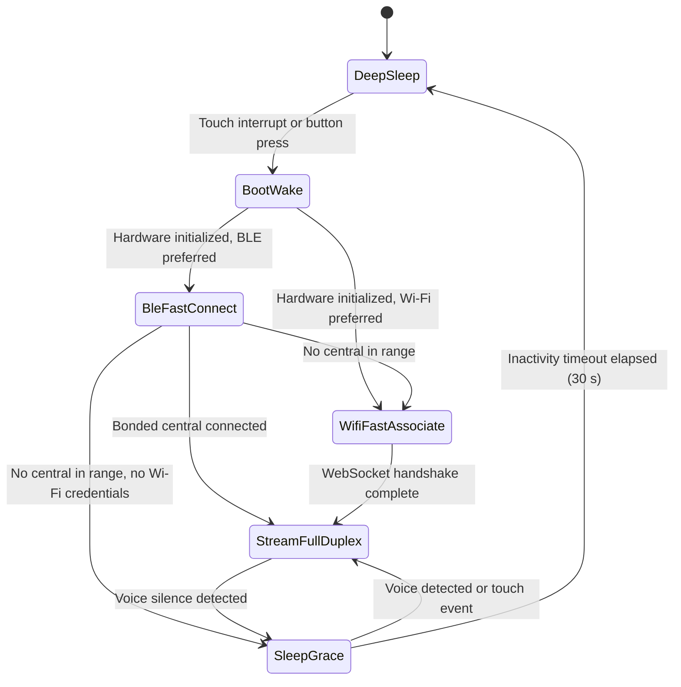

# BOHS-01 Architecture Specification

The Bulle Open Hardware Standard (BOHS-01) defines physical, electrical, and operational requirements for wearable artificial intelligence peripherals.

## Device classification

A BOHS-01 device operates strictly as a sensor and actuator peripheral. It does not run a general-purpose operating system, an application store, or a local large language model.

Traditional smart devices embed full operating systems like Android or Linux. That choice increases bill of materials costs, causes thermal throttling, drains batteries in hours, and requires fragile local application runtimes.

BOHS-01 splits the system cleanly:

1. The peripheral captures human intent through digital microphones and touch sensors.
2. The peripheral presents agent output through speakers, displays, and haptic actuators.
3. The server gateway executes all heavy computation: speech recognition, language reasoning, tool execution, and voice synthesis.

This division keeps the physical peripheral cheap, cool, reliable, and instantly responsive.

## Physical specification

### Form factor and geometry

A BOHS-01 device uses a circular disc geometry with a maximum outer diameter of 38.0 mm and a maximum thickness of 11.5 mm including enclosure walls.

This form factor enables versatile wearable attachments:

- Magnetic pendant on a neck chain or cord
- Spring-clip brooch for lapels and shirt pockets
- Wristband adapter cradle

### Thermal constraints

The exterior case temperature must not exceed 40.0°C under continuous operational load in a 25.0°C ambient environment. This threshold complies with IEC 62368-1 standards for wearable consumer electronics in continuous contact with human skin.

The hardware achieves this thermal budget through three mechanisms:

- Hardware duty cycling of the radio transceiver
- Class-D audio amplification with efficiency exceeding 88 percent
- Offloading machine learning inference to the gateway server

### Bill of materials target

The total hardware bill of materials (BOM) target is under $25.00 USD at a production volume of 1,000 units.

| Subsystem | Component | Reference part | Target cost (1k qty) |
| :--- | :--- | :--- | :--- |
| Microcontroller | Dual-core Xtensa 32-bit LX7 MCU with Wi-Fi and BLE 5.0 | ESP32-S3R8 (QFN, 8 MB in-package PSRAM) | $2.85 |
| Audio Input | I2S digital MEMS microphone with 64 dB SNR | Knowles SPH0645LM4H-B / INMP441 | $0.95 |
| Audio Output | Mono 3.2W Class-D I2S audio amplifier | Maxim MAX98357AETE+ | $0.85 |
| Speaker Transducer | Miniature dynamic speaker 8 Ohm 1W (20mm diameter) | CUI Devices CDS-20148 | $1.20 |
| Display | 1.28-inch round IPS TFT LCD (240x240 SPI) | GC9A01 driver | $3.40 |
| Actuator | LRA / ERM miniature vibration motor with driver | TI DRV2605LDGSR + 0827 motor | $1.40 |
| Power Management | Single-cell Li-ion linear charger, 333 mA, Schottky load sharing | TP4056 (SOP-8) + 2x 1N5819WS | $0.65 |
| Voltage Regulation | Ultra-low quiescent current LDO 3.3V 500mA | TI TPS7A0533PDBVR | $0.35 |
| Battery Cell | Rechargeable Lithium Polymer cell 3.7V 350mAh | 502035 pouch cell | $2.10 |
| PCB | 4-layer FR4 high-density interconnect round board | 38mm circular board | $1.80 |
| Enclosure | Injection molded or SLA resin enclosure with front lens | Two-piece snap case | $2.50 |
| Passives and Connectors | USB-C receptacle, ESD diodes, resistors, capacitors | Standard SMT passives | $1.60 |
| Assembly and Testing | Surface mount assembly and automated flashing | Turnkey PCBA | $4.20 |
| **Total** | | | **$23.85** |

### Charging and power path

The reference hardware charges its cell with a TP4056 linear charger in a SOP-8 package.

- `R_PROG` is 3.6 kOhm. The TP4056 sets charge current as 1200 / R_PROG, so the cell charges at about 333 mA.
- 333 mA is about 0.95C for the 350 mAh cell.
- Two 1N5819WS Schottky diodes share the load. `D_SYS` runs from `VBUS` to `VSYS`. `D_PATH` runs from `VBAT` to `VSYS`. When USB-C is present, `VBUS` feeds `VSYS` and the charger fills the cell. When USB-C is absent, the battery feeds `VSYS`.
- A TPS7A0533 LDO produces the 3.3 V rail from `VSYS`.

### Battery life specifications

The reference hardware runs on a single-cell 350 mAh lithium polymer battery (1.295 Wh nominal energy).

Every figure in this table is a design target. None of them is a measurement yet.

| Operating mode | Average current draw (target) | Duration (target) |
| :--- | :--- | :--- |
| Deep sleep | 18 uA | > 18 days (> 430 hours) |
| Active voice streaming, BLE 5.0 2M PHY relay | 14 mA | > 24.0 hours |
| Active voice streaming, Wi-Fi WSS direct | 42 mA | > 8.3 hours |
| Burst tool interaction | 68 mA (display, haptics, speaker active) | > 5.1 hours |
| Mixed daily usage profile | 2 hours active stream on Wi-Fi, 22 hours deep sleep | 3.8 days between charges |

## Transports

A BOHS-01 device carries the same `bohs.v1` frames over three transports. The frame format does not change between them. Only the outer framing changes. [BOHS-01-WIRE.md](BOHS-01-WIRE.md) defines both.

| Transport | Link | Peer | Use |
| :--- | :--- | :--- | :--- |
| `BleRelay` | BLE 5.0 GATT, 2M PHY, service `b0010000-f4c1-4e00-b001-000000000001` | Bulle mobile or desktop app, which relays frames to the gateway | Default when a bonded phone or laptop is in range. Also the only pairing path. |
| `WifiDirect` | Wi-Fi WSS to `/api/hardware/ws` | Bulle gateway | Fallback when no bonded central is in range and Wi-Fi credentials are provisioned. |
| `UsbSerial` | USB-C CDC ACM on `GPIO19` (D-) and `GPIO20` (D+) | Bulle desktop or CLI on the host computer | Desk mode and debugging while plugged in. |

### Transport selection

1. When USB-C is connected to a host that opens the CDC port, the device uses `UsbSerial`.
2. Otherwise, a provisioned device with `prefer_ble = true` tries `BleRelay` first.
3. If no bonded central connects within the BLE connect window, and the device holds Wi-Fi credentials, the device falls back to `WifiDirect`.
4. If the BLE link drops during a session, the device runs step 3 again.
5. A device with `prefer_ble = false` tries `WifiDirect` first and uses `BleRelay` when Wi-Fi association fails.

### Pairing

A new device starts in the `unclaimed` state and advertises the BOHS-01 service. The user pairs it from the Bulle app:

1. The app bonds with the device over BLE LE Secure Connections.
2. The app sends `prov.identify`. The device pulses its haptic motor, draws a pairing ring on the LCD, and opens a 60 second window.
3. The user taps the capacitive pad (`GPIO7`, net `TOUCH_WAKE`) inside that window. The device moves to `authorized`.
4. The app claims the device with Bulle and receives a `bohs_tok_` device token.
5. The app writes `prov.configure` with the gateway URL, the token, and optional Wi-Fi credentials. The device stores them in NVS and moves to `provisioned`.

If the window ends before step 5, a new device returns to `unclaimed`. [BOHS-01-WIRE.md](BOHS-01-WIRE.md) defines the provisioning messages and their security rules. [BOHS-01-GATEWAY.md](BOHS-01-GATEWAY.md) defines the claim endpoint.

## Power states and transitions

The device firmware implements six discrete power states to maximize battery longevity.

### State descriptions

#### Deep sleep

All main power rails shut down except the ultra-low-power (ULP) coprocessor and the real-time clock (RTC) controller. RTC memory keeps the cached Wi-Fi BSSID and radio channel. NVS flash keeps the provisioning config (gateway URL, device token, Wi-Fi credentials, transport preference) and the BLE bond keys.

- Current consumption: 18 uA typical, 25 uA maximum (target).
- Active peripherals: RTC timer, capacitive touch sensing pad on `GPIO7`.
- Clocks: 32.768 kHz RTC crystal oscillator.

#### Boot and wake

A capacitive touch event or physical button press triggers an RTC interrupt. The internal DC-DC converter powers up the high-speed CPU cores.

- Current consumption: 22 mA.
- Duration: Under 50 ms from trigger signal to firmware entry point (target).
- Tasks: Initialize I2S audio bus, power peripheral regulators, load cached connection state from RTC memory and NVS.

#### BLE fast connect

The device starts advertising the BOHS-01 service to its bonded central. The central reconnects and resumes the encrypted link with the stored bond keys.

- Advertising start: Under 6 ms after firmware entry (target).
- Exit criteria: A bonded central connects and enables notifications, which moves the device to full-duplex stream. If no central connects within the BLE connect window, the device moves to Wi-Fi fast associate when it holds Wi-Fi credentials, or back to sleep grace when it does not.

#### Wi-Fi fast associate

The radio transceiver connects directly to the cached wireless access point using pre-negotiated parameters. The client skips full channel scanning and reuses its DHCP lease.

- Current consumption: 110 mA average during radio transmission.
- Duration: Under 800 ms from cold wake to established TCP socket (target).
- Tasks: Direct frame association to target BSSID, TLS session resumption, WebSocket upgrade request.

#### Full-duplex stream

The primary operational state. The microphone continuously feeds 16 kHz PCM16 audio frames upstream. The speaker plays synthesized speech downstream. The display shows real-time avatar expressions.

- Current consumption (target): 14 mA average on BLE relay, 42 mA average on Wi-Fi direct.
- Active peripherals: Dual-core CPU running at 160 MHz, BLE or Wi-Fi radio, I2S microphone, I2S amplifier, SPI display.
- Tasks: PCM16 framing, `bohs.v1` multiplexing, transport framing, Reverse MCP tool execution.

#### Sleep grace

When voice activity detection signals end of speech and no downstream audio plays, the device drops into sleep grace. The display dims and the audio power amplifier turns off.

- Current consumption: 14 mA.
- Duration: 30 seconds inactivity window.
- Purpose: Prevents costly radio reconnection cycles during multi-turn human conversation.
- Exit criteria: Voice resumption immediately restores full-duplex stream; timer expiration triggers entry into deep sleep.
