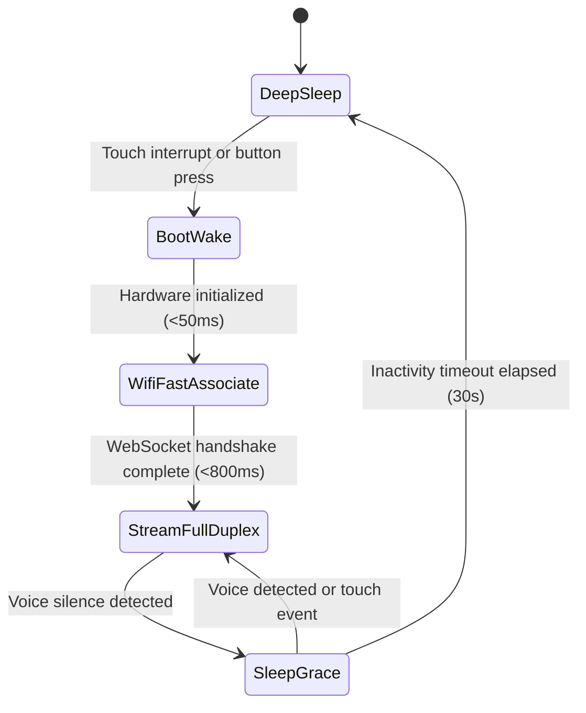

# BOHS-01 Architecture Specification

The Bulle Open Hardware Standard (BOHS-01) defines physical, electrical, and operational requirements for wearable artificial intelligence peripherals.

## Device classification

A BOHS-01 device operates strictly as a sensor and actuator peripheral. It does not run a general-purpose operating system, an application store, or a local large language model.

Traditional smart devices embed full operating systems like Android or Linux. That choice increases bill of materials costs, causes thermal throttling, drains batteries in hours, and requires fragile local application runtimes.

BOHS-01 splits the system cleanly:

1. The peripheral captures human intent through digital microphones and touch sensors.
2. The peripheral presents agent output through speakers, displays, and haptic actuators.
3. The server gateway executes all heavy computation: speech recognition, language reasoning, tool execution, and voice synthesis.

This division keeps the physical peripheral cheap, cool, reliable, and instantly responsive.

## Physical specification

### Form factor and geometry

A BOHS-01 device uses a circular disc geometry with a maximum outer diameter of 38.0 mm and a maximum thickness of 11.5 mm including enclosure walls.

This form factor enables versatile wearable attachments:

- Magnetic pendant on a neck chain or cord
- Spring-clip brooch for lapels and shirt pockets
- Wristband adapter cradle

### Thermal constraints

The exterior case temperature must not exceed 40.0°C under continuous operational load in a 25.0°C ambient environment. This threshold complies with IEC 62368-1 standards for wearable consumer electronics in continuous contact with human skin.

The hardware achieves this thermal budget through three mechanisms:

- Hardware duty cycling of the radio transceiver
- Class-D audio amplification with efficiency exceeding 88 percent
- Offloading machine learning inference to the gateway server

### Bill of materials target

The total hardware bill of materials (BOM) target is under $25.00 USD at a production volume of 1,000 units.

| Subsystem | Component | Reference part | Target cost (1k qty) |
| :--- | :--- | :--- | :--- |
| Microcontroller | Dual-core Xtensa 32-bit LX7 MCU with Wi-Fi and BLE | ESP32-S3-WROOM-1 | $2.85 |
| Audio Input | PDM digital MEMS microphone with 64 dB SNR | Knowles SPH0645LM4H | $0.95 |
| Audio Output | Mono 3.2W Class-D I2S audio amplifier | Maxim MAX98357AETE+ | $0.85 |
| Speaker Transducer | Miniature dynamic speaker 8 Ohm 1W (20mm diameter) | CUI Devices CDS-20148 | $1.20 |
| Display | 1.28-inch round IPS TFT LCD (240x240 SPI) | GC9A01 driver | $3.40 |
| Actuator | LRA / ERM miniature vibration motor with driver | TI DRV2605LDGSR + 0827 motor | $1.40 |
| Power Management | Single-cell Li-ion linear charger with dynamic power path | TI BQ24040DSQR | $0.65 |
| Voltage Regulation | Ultra-low quiescent current LDO 3.3V 500mA | TI TPS7A0533PDBVR | $0.35 |
| Battery Cell | Rechargeable Lithium Polymer cell 3.7V 350mAh | 502035 pouch cell | $2.10 |
| PCB | 4-layer FR4 high-density interconnect round board | 38mm circular board | $1.80 |
| Enclosure | Injection molded or SLA resin enclosure with front lens | Two-piece snap case | $2.50 |
| Passives and Connectors | USB-C receptacle, ESD diodes, resistors, capacitors | Standard SMT passives | $1.60 |
| Assembly and Testing | Surface mount assembly and automated flashing | Turnkey PCBA | $4.20 |
| **Total** | | | **$23.85** |

### Battery life specifications

The reference hardware runs on a single-cell 350 mAh lithium polymer battery (1.295 Wh nominal energy).

| Operating mode | Average current draw | Target duration |
| :--- | :--- | :--- |
| Deep sleep | 18 uA | > 18 days (> 430 hours) |
| Active voice streaming | 42 mA | > 8.3 hours |
| Burst tool interaction | 68 mA (display, haptics, speaker active) | > 5.1 hours |
| Mixed daily usage profile | 2 hours active stream, 22 hours deep sleep | 3.8 days between charges |

## Power states and transitions

The device firmware implements five discrete power states to maximize battery longevity.

### State descriptions

#### Deep sleep

All main power rails shut down except the ultra-low-power (ULP) coprocessor and the real-time clock (RTC) controller. Internal SRAM retains Wi-Fi network credentials, BSSID, radio channel, and gateway session tokens.

- Current consumption: 18 uA typical, 25 uA maximum.
- Active peripherals: RTC timer, capacitive touch sensing pads on GPIO pins.
- Clocks: 32.768 kHz RTC crystal oscillator.

#### Boot and wake

A capacitive touch event or physical button press triggers an RTC interrupt. The internal DC-DC converter powers up the high-speed CPU cores.

- Current consumption: 22 mA.
- Duration: Under 50 ms from trigger signal to firmware entry point.
- Tasks: Initialize I2S audio bus, power peripheral regulators, load cached connection state from RTC memory.

#### Wi-Fi fast associate

The radio transceiver connects directly to the cached wireless access point using pre-negotiated parameters. The client skips full channel scanning and reuses its DHCP lease.

- Current consumption: 110 mA average during radio transmission.
- Duration: Under 800 ms from cold wake to established TCP socket.
- Tasks: Direct frame association to target BSSID, TLS session resumption, WebSocket upgrade request.

#### Full-duplex stream

The primary operational state. The microphone continuously feeds 16 kHz audio frames upstream to the server. The speaker plays synthesized speech downstream. The display shows real-time avatar expressions.

- Current consumption: 42 mA nominal during voice playback, 38 mA during voice capture.
- Active peripherals: Dual-core CPU running at 160 MHz, Wi-Fi radio, I2S microphone, I2S amplifier, SPI display.
- Tasks: Opus encoding, Opus decoding, WebSocket multiplexing, Reverse MCP tool execution.

#### Sleep grace

When voice activity detection signals end of speech and no downstream audio plays, the device drops into sleep grace. The display dims and the audio power amplifier turns off.

- Current consumption: 14 mA.
- Duration: 30 seconds inactivity window.
- Purpose: Prevents costly Wi-Fi reassociation cycles during multi-turn human conversation.
- Exit criteria: Voice resumption immediately restores full-duplex stream; timer expiration triggers entry into deep sleep.
