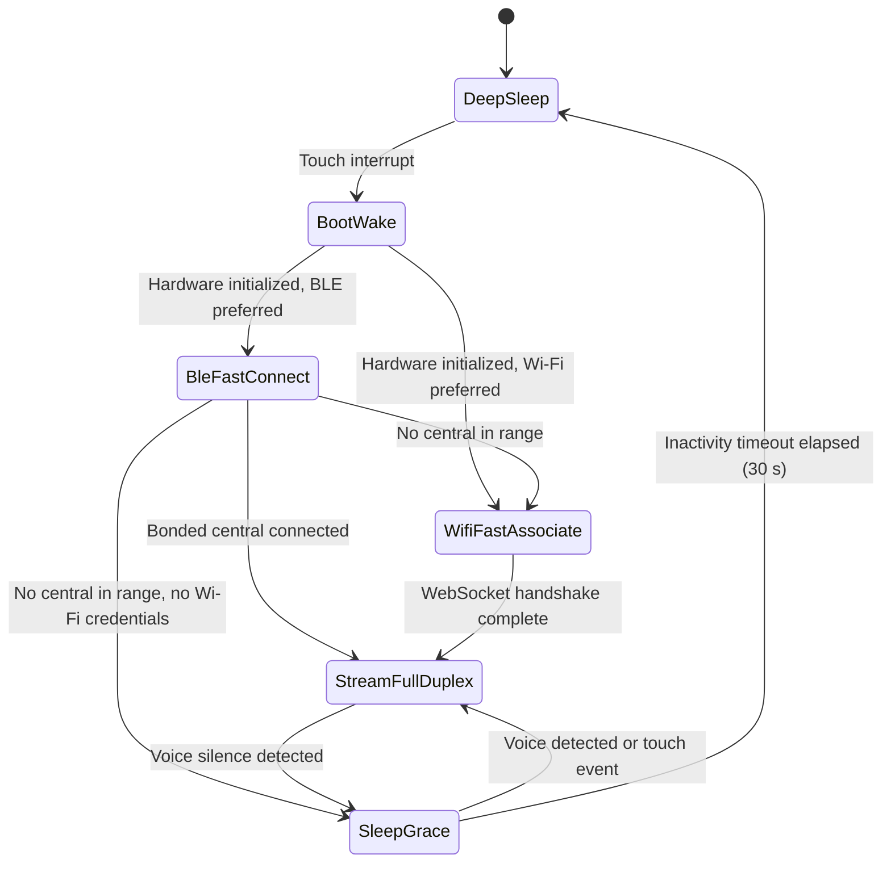

# BOHS-01 Architecture Specification

The Bulle Open Hardware Standard (BOHS-01) defines how physical devices give an AI agent hands and senses. A device advertises tools, the agent calls them, and the device acts.

## Core and profiles

BOHS-01 has one core and two device profiles.

The **core** is the wire protocol and the gateway contract: the `bohs.v1` frames in [BOHS-01-WIRE.md](BOHS-01-WIRE.md) and the claim, session and tool rules in [BOHS-01-GATEWAY.md](BOHS-01-GATEWAY.md). Every BOHS-01 device implements the core, whatever it runs on.

A **profile** adds the physical and power rules for one kind of device. It sets the `device_class` the device claims with.

| Profile | `device_class` | What it is | Reference |
| :--- | :--- | :--- | :--- |
| Charm | `charm` | Wearable on a battery: a 38 mm board, no operating system, deep sleep | Pastille |
| Field | `field` | Fixed device on mains power, such as a light switch, a sensor or a lock. Any hardware and any operating system. | `examples/bohs-switch` on a Raspberry Pi |

`totem` is reserved for a future table-top profile.

The rest of this document is the **charm profile**. A field device needs only the core and the field rules below.

### Field profile

A field device:

1. Implements the core over Wi-Fi WSS or Ethernet. BLE and USB are optional.
2. Pairs with a typed code, since it may sit in another city from the app that claims it. See code pairing in [BOHS-01-GATEWAY.md](BOHS-01-GATEWAY.md).
3. Keeps its device token in storage only its own process can read, and survives a reboot without pairing again.
4. Sets capability bit `0x10` when it switches a load, and lists the `switch.*` tools from [BOHS-01-WIRE.md](BOHS-01-WIRE.md).
5. Keeps mains voltage off its own board. It drives an isolated, enclosed relay or a low-voltage load, never a bare relay module on mains.
6. Drives its outputs to a safe state (off, unless configured otherwise) when it boots. It keeps their state when it loses the gateway, so a network drop never switches a light.

## Device classification (charm profile)

A charm operates strictly as a sensor and actuator peripheral. It does not run a general-purpose operating system, an application store, or a local large language model.

Traditional smart devices embed full operating systems like Android or Linux. On a wearable that choice increases bill of materials costs, causes thermal throttling, drains batteries in hours, and requires fragile local application runtimes.

The charm profile splits the system cleanly:

1. The peripheral captures human intent through digital microphones and touch sensors.
2. The peripheral presents agent output through speakers, displays, and haptic actuators.
3. The server gateway executes all heavy computation: speech recognition, language reasoning, tool execution, and voice synthesis.

This division keeps the physical peripheral cheap, cool, reliable, and instantly responsive.

## Physical specification

### Form factor and geometry

A charm uses a circular disc geometry. The board is at most 38.0 mm across. The enclosure is at most 42.5 mm across and 14.0 mm thick, walls included.

This form factor enables versatile wearable attachments:

- Magnetic pendant on a neck chain or cord
- Spring-clip brooch for lapels and shirt pockets
- Wristband adapter cradle

### Enclosure and stack

The reference enclosure has three printed parts and five bought parts. `hardware/bodies/build.ts` builds all of them from the board kit (`bodies/kit/main/kit.json`), so the case follows the board when parts move. `fusible assembly` checks that every part fits.

Heights are in mm, measured from the board's mid-plane.

| Part | Body | From | To | Notes |
| :--- | :--- | :--- | :--- | :--- |
| Front bezel | `front_bezel` | 0.80 | 7.20 | Window of 32.4 mm over the active area. Two screw bosses on the board holes. |
| Lens | `lens` | 5.80 | 6.60 | Clear disc, 35.0 x 0.8 mm. The bezel lip holds it from the front. |
| LCD | `lcd` | 4.20 | 5.70 | GC9A01 1.28" panel (ZJY128R-IG01): 35.6 mm frame, 32.4 mm active area, 1.5 mm thick, FPC ledge toward `J_LCD`. |
| Board | `main` | -0.80 | 0.80 | 38 mm, 4 layers, 1.6 mm. The tallest top part is the USB-C shell (3.16 mm). |
| Battery | `battery` | -5.30 | -1.30 | 402020 cell. 0.5 mm swell room on every face. |
| Speaker | `speaker` | -5.50 | -3.00 | Face down over a grille of 1 mm holes, under the USB-C side. |
| LRA | `lra` | -5.80 | -2.60 | 8 x 3.2 mm coin motor, glued to the floor. |
| Back shell | `back_shell` | -6.80 | 1.80 | Cup with pockets, mic port, USB-C opening, lead channel and lanyard lug. |

The outer diameter is 42.4 mm. The v0.4 reference case is 14.0 mm thick, which meets the 14.0 mm limit with no margin.

The board has a flat edge at y = -18.557 mm. The USB-C receptacle front face sits on that flat, so a plug seats fully and its overmold clears the board. The case opening leaves 0.3 mm around the overmold. The USB-C opening is the only opening in the case wall. No other part sits within 1 mm of the board edge, so the case needs no other wall slot.

Every part is surface-mount except the four shell legs of the USB-C receptacle. The cell keeps more than 5 mm from those legs and from both screw holes, so it sits 0.5 mm under the board.

#### Battery choice

The battery sits under the board, beside the speaker, the LRA, the mic port and the two screw bosses.

| Cell | Size (mm) | Capacity | Fits | Why |
| :--- | :--- | :--- | :--- | :--- |
| 502035 | 35 x 20 x 5 | 350 mAh | No | With swell room it needs a 41.7 mm circle. The cavity is 40 mm. |
| 402030 | 30 x 20 x 4 | 300 mAh | No | It fits the circle, but not around the mic port and the two screw bosses, even without the speaker. |
| 402020 | 20 x 20 x 4 | 120 mAh | Yes | The largest common cell that leaves room for the speaker and the LRA. |

The reference cell is the LP402020 from li-polymer-battery.com: 120 mAh, with a protection circuit (PCM), no thermistor, 120 mA maximum continuous discharge. Some sellers list 402020 cells at 150 mAh, but the orderable cell with a datasheet and a PCM is rated 120 mAh, so every figure below uses 120 mAh. Order it with a JST SH 2-pin plug: red lead on `J_BAT` pin 1 (`VBAT`), black lead on pin 2 (`GND`).

#### Printing and assembly

1. Print `bodies/front_bezel.stl` face down and `bodies/back_shell.stl` floor down, in PLA or PETG, 0.12 mm layers. The bezel screw bosses start on the panel shoulder; enable supports if your slicer flags them. Cut or print `bodies/lens.stl` in clear acrylic or resin.
2. Stick a 4 mm mesh sticker into the 0.6 mm recess around the mic port, on the outside of the shell. The recess keeps fabric off the port. Put a 0.2 mm gasket ring on top of the mic tube.
3. Solder the speaker leads to the `J_SPK` pads and the LRA leads to the `J_HAP` pads, on the bottom of the board.
4. Glue the LRA into its ring, put the speaker face down on its seat, and drop the battery into its pocket. Run the battery leads up the channel at the `J_BAT` side and plug them into `J_BAT`.
5. Lay the board on the shell bosses, components up, with `J_USB` in the USB-C opening.
6. Stick a 1 mm foam pad on the ESP32-S3 module shield. Glue the lens into the bezel recess, then stick the LCD panel behind it and fold its FPC into `J_LCD`.
7. Close the bezel over the shell lip and drive two M2 x 8 mm self-tapping screws from the back.

The case fits the models, not yet the real parts. The LCD and battery sizes come from drawings, so one test print is needed before anyone calls the case final.

### Thermal constraints

The exterior case temperature must not exceed 40.0°C under continuous operational load in a 25.0°C ambient environment. This threshold complies with IEC 62368-1 standards for wearable consumer electronics in continuous contact with human skin.

The hardware achieves this thermal budget through three mechanisms:

- Hardware duty cycling of the radio transceiver
- Class-D audio amplification with efficiency exceeding 88 percent
- Offloading machine learning inference to the gateway server

### Bill of materials target

The total hardware bill of materials (BOM) target is under $25.00 USD at a production volume of 1,000 units. Part prices come from `bom.yml` (run `fusible bom`). They are estimates at 1,000 units, not quotes.

| Subsystem | Component | Reference part | Target cost (1k qty) |
| :--- | :--- | :--- | :--- |
| Microcontroller | ESP32-S3 module with 4 MB flash, 2 MB PSRAM, 40 MHz crystal and PCB antenna | Espressif ESP32-S3-MINI-1-N4R2 | $3.10 |
| Audio input | I2S digital MEMS microphone | Knowles SPH0645LM4H-B | $0.95 |
| Audio output | Mono class-D I2S amplifier, gain set to 6 dB | Analog Devices MAX98357AETE+ | $0.85 |
| Speaker | Micro speaker 8 Ohm 1 W, 15 x 11 x 2.5 mm | Same Sky CMS-151125-18S-X8 | $1.60 |
| Display | 1.28-inch round IPS panel, 240 x 240, FPC connector, backlight switch | ZJY128R-IG01, Hirose FH34SRJ-12S-0.5SH(50), AO3400A | $3.88 |
| Actuator | LRA driver and 8 mm coin LRA | TI DRV2605LDGSR, Vybronics VG0832012 | $2.60 |
| Power | Linear charger, P-MOSFET power path, 600 mA LDO, battery header | TP4056-42-ESOP8, AO3401A, 1N5819WS, RT9080-33GJ5, JST SM02B-SRSS-TB | $0.49 |
| USB | USB-C receptacle, D+/D- ESD array, VBUS TVS | SHOU HAN TYPE-C 16PIN 2MD(073), USBLC6-2SC6, SMF5.0A | $0.23 |
| Passives | Resistors and capacitors | Yageo RC0402, Murata GRM | $0.20 |
| Battery cell | LiPo 3.7 V 120 mAh with PCM | LP402020 (20 x 20 x 4 mm) | $1.60 |
| PCB | 4-layer FR4, 38 mm round | 38 mm circular board | $1.80 |
| Enclosure | Printed bezel, back shell and lens, foam pad, two screws | M2 x 8 mm screws | $0.30 |
| Assembly and testing | Surface mount assembly and automated flashing | Turnkey PCBA | $4.20 |
| **Total** | | | **$21.80** |

### Microcontroller module

The board carries an ESP32-S3-MINI-1-N4R2 module, which integrates the ESP32-S3 chip, 4 MB flash, 2 MB PSRAM, the 40 MHz crystal, the RF match and a PCB antenna. Sources: https://documentation.espressif.com/esp32-s3-mini-1_mini-1u_datasheet_en.pdf (pin table 3-1, land pattern figure 11-1, peripheral schematic figure 9-1) and https://docs.espressif.com/projects/esp-hardware-design-guidelines/en/latest/esp32s3/pcb-layout-design.html (module placement and antenna keep-out).

- The module sits with its antenna toward -X, its antenna edge 1 mm inside the board edge. No copper sits under the antenna or between it and the board edge on any layer (an 8.2 x 17 mm keep-out).
- The LCD panel covers the whole disc, the antenna included. The guide asks for 15 mm of clearance around the antenna, which no 42 mm wearable can give. Radio range needs a measurement on the first prototype.
- The module keeps every GPIO number of v0.3: the signals sit on GPIO1, 2 and 4 to 21. GPIO26 drives the in-package PSRAM of the -N4R2 version, and the board leaves it open.
- `EN` has a 10 kOhm pull-up and a 1 uF capacitor to ground, the RC delay the datasheet recommends. The 3.3 V pin has 22 uF and 100 nF next to it.
- Strapping pins: `GPIO0` has a 10 kOhm pull-up, so the chip boots from flash. `GPIO3`, `GPIO45` and `GPIO46` stay open, so their internal pull resistors select the defaults (3.3 V flash, normal boot, USB-Serial-JTAG).
- Flashing runs over the native USB-Serial-JTAG on `GPIO19` and `GPIO20`. `espflash` resets the chip into download mode over USB, so no button is needed. For recovery, the board has three test pads under the LCD: `TP_EN`, `TP_BOOT` and `TP_GND`. Short `TP_BOOT` to `TP_GND` while you plug in USB to force download mode.

### Charging and power path

The reference hardware charges its cell with a TP4056 linear charger in an ESOP-8 package with its exposed pad on ground. Source: https://datasheet.lcsc.com/lcsc/2311091738_UMW-Youtai-Semiconductor-Co---Ltd--TP4056_C725790.pdf

- `R_PROG` is 18 kOhm. The TP4056 sets charge current as 1200 / R_PROG, so the cell charges at about 67 mA, which is 0.56C for the 120 mAh cell. A full charge takes about 2.5 hours.
- `TEMP` is grounded. The datasheet disables temperature sensing that way, and the reference cell has no thermistor. The cell's own PCM gives over-charge, over-discharge and short-circuit protection. A cell without a PCM is not allowed.
- A 1N5819WS Schottky diode (`D_SYS`) runs from `VBUS` to `VSYS`. An AO3401A P-MOSFET (`Q_PATH`) runs from `VBAT` to `VSYS`, with its gate on `VBUS` and a 100 kOhm pull-down. With USB-C present, the gate is high, the MOSFET is off, `VBUS` feeds `VSYS` and the charger fills the cell. With USB-C absent, the gate is low and the battery feeds `VSYS` through the MOSFET, with no diode drop.
- An RT9080-33GJ5 LDO makes the 3.3 V rail from `VSYS`. It is rated 600 mA, draws 2 uA of quiescent current, and drops 0.31 V typical at 600 mA. It covers the 355 mA Wi-Fi transmit peak of the module. Source: https://www.richtek.com/assets/product_file/RT9080/DS9080-09.pdf
- `USB_DM` and `USB_DP` pass through a USBLC6-2SC6 ESD array next to the receptacle. `VBUS` has an SMF5.0A TVS.
- The LCD backlight runs from 3.3 V through a 10 Ohm resistor and an AO3400A low-side switch on `LCD_BL` (`GPIO21`), active high, with a 100 kOhm pull-down that keeps it off during boot. The panel's two white LEDs draw 20 to 40 mA at a forward voltage of 2.9 to 3.1 V.
- Power traces are 0.3 mm wide (`VBAT` 0.4 mm), ground traces 0.25 mm. The bottom layer carries a ground pour.

### Battery life specifications

The reference hardware runs on a single-cell 120 mAh lithium polymer battery (0.44 Wh nominal). The budget counts 108 mAh as usable (90 percent).

Every figure below is a design estimate from datasheet typicals. None of them is a measurement yet.

| Rail load (typical) | Deep sleep | BLE stream | Wi-Fi stream | Speaking burst |
| :--- | ---: | ---: | ---: | ---: |
| ESP32-S3 module: deep sleep with touch wake, or 80 MHz with peripherals on | 0.018 mA | 36 mA | 36 mA | 36 mA |
| Radio, averaged over the stream | 0 | 25 mA | 60 mA | 25 mA |
| LCD panel: sleep-in, or on | 0.020 mA | 8.5 mA | 8.5 mA | 8.5 mA |
| Backlight at 50 percent PWM | 0 | 15 mA | 15 mA | 15 mA |
| Microphone: sleep, or on | 0.003 mA | 0.6 mA | 0.6 mA | 0.6 mA |
| Amplifier: shutdown, or speech at moderate volume | 0.001 mA | 0 | 0 | 50 mA |
| Haptic driver standby | 0.004 mA | 0.004 mA | 0.004 mA | 0.004 mA |
| LDO, charger, cell PCM and battery divider | 0.009 mA | 0.009 mA | 0.009 mA | 0.009 mA |
| **Average current** | **0.055 mA** | **85 mA** | **120 mA** | **135 mA** |
| **Duration on 108 mAh** | **about 82 days** | **about 1.3 hours** | **about 0.9 hours** | **about 0.8 hours** |

A day of 20 minutes of BLE streaming and the rest in deep sleep uses 28 mAh plus 1.3 mAh, so the cell lasts about 3.7 days between charges. LiPo self-discharge of a few percent per month cuts the deep sleep figure in practice.

The Wi-Fi stream sits at the cell's 120 mA continuous rating, and its 355 mA transmit peaks are about 3C. A cell with 1 Ohm of internal resistance sags about 0.35 V at those peaks, which brings the 3.3 V rail near the 3.0 V module minimum below about 3.6 V of cell voltage. BLE relay is the default transport for that reason. Both need a measurement on the first prototype.

## Transports

A BOHS-01 device carries the same `bohs.v1` frames over three transports. The frame format does not change between them. Only the outer framing changes. [BOHS-01-WIRE.md](BOHS-01-WIRE.md) defines both.

| Transport | Link | Peer | Use |
| :--- | :--- | :--- | :--- |
| `BleRelay` | BLE 5.0 GATT, 2M PHY, service `b0010000-f4c1-4e00-b001-000000000001` | Bulle mobile or desktop app, which relays frames to the gateway | Default when a bonded phone or laptop is in range. Also the only pairing path. |
| `WifiDirect` | Wi-Fi WSS to `/api/hardware/ws` | Bulle gateway | Fallback when no bonded central is in range and Wi-Fi credentials are provisioned. |
| `UsbSerial` | USB-C CDC ACM on `GPIO19` (D-) and `GPIO20` (D+) | Bulle desktop or CLI on the host computer | Desk mode and debugging while plugged in. |

### Transport selection

1. When USB-C is connected to a host that opens the CDC port, the device uses `UsbSerial`.
2. Otherwise, a provisioned device with `prefer_ble = true` tries `BleRelay` first.
3. If no bonded central connects within the BLE connect window, and the device holds Wi-Fi credentials, the device falls back to `WifiDirect`.
4. If the BLE link drops during a session, the device runs step 3 again.
5. A device with `prefer_ble = false` tries `WifiDirect` first and uses `BleRelay` when Wi-Fi association fails.

### Pairing

A new device starts in the `unclaimed` state and advertises the BOHS-01 service. The user pairs it from the Bulle app:

1. The app bonds with the device over BLE LE Secure Connections.
2. The app sends `prov.identify`. The device pulses its haptic motor, draws a pairing ring on the LCD, and opens a 60 second window.
3. The user taps the capacitive pad (`GPIO7`, net `TOUCH_WAKE`) inside that window. The device moves to `authorized`.
4. The app claims the device with Bulle and receives a `bohs_tok_` device token.
5. The app writes `prov.configure` with the gateway URL, the token, and optional Wi-Fi credentials. The device stores them in NVS and moves to `provisioned`.

If the window ends before step 5, a new device returns to `unclaimed`. [BOHS-01-WIRE.md](BOHS-01-WIRE.md) defines the provisioning messages and their security rules. [BOHS-01-GATEWAY.md](BOHS-01-GATEWAY.md) defines the claim endpoint.

## Power states and transitions

The device firmware implements six discrete power states to maximize battery longevity.

### State descriptions

#### Deep sleep

All main power rails shut down except the ultra-low-power (ULP) coprocessor and the real-time clock (RTC) controller. RTC memory keeps the cached Wi-Fi BSSID and radio channel. NVS flash keeps the provisioning config (gateway URL, device token, Wi-Fi credentials, transport preference) and the BLE bond keys.

- Current consumption: 55 uA for the whole board, 18 uA of it in the ESP32-S3 module with touch wake (estimate, see the battery life table).
- Active peripherals: RTC timer, capacitive touch sensing pad on `GPIO7`.
- Clocks: the internal 136 kHz RC oscillator. The module has no 32.768 kHz crystal.

#### Boot and wake

A capacitive touch event triggers an RTC interrupt, and the chip powers up its CPU cores.

- Current consumption: 22 mA.
- Duration: Under 50 ms from trigger signal to firmware entry point (target).
- Tasks: Initialize I2S audio bus, power peripheral regulators, load cached connection state from RTC memory and NVS.

#### BLE fast connect

The device starts advertising the BOHS-01 service to its bonded central. The central reconnects and resumes the encrypted link with the stored bond keys.

- Advertising start: Under 6 ms after firmware entry (target).
- Exit criteria: A bonded central connects and enables notifications, which moves the device to full-duplex stream. If no central connects within the BLE connect window, the device moves to Wi-Fi fast associate when it holds Wi-Fi credentials, or back to sleep grace when it does not.

#### Wi-Fi fast associate

The radio transceiver connects directly to the cached wireless access point using pre-negotiated parameters. The client skips full channel scanning and reuses its DHCP lease.

- Current consumption: 110 mA average during radio transmission.
- Duration: Under 800 ms from cold wake to established TCP socket (target).
- Tasks: Direct frame association to target BSSID, TLS session resumption, WebSocket upgrade request.

#### Full-duplex stream

The primary operational state. The microphone continuously feeds 16 kHz PCM16 audio frames upstream. The speaker plays synthesized speech downstream. The display shows real-time avatar expressions.

- Current consumption (estimate): 85 mA average on BLE relay, 120 mA average on Wi-Fi direct, display on.
- Active peripherals: CPU at 80 MHz (160 MHz adds about 6 mA), BLE or Wi-Fi radio, I2S microphone, I2S amplifier, SPI display.
- Tasks: PCM16 framing, `bohs.v1` multiplexing, transport framing, Reverse MCP tool execution.

#### Sleep grace

When voice activity detection signals end of speech and no downstream audio plays, the device drops into sleep grace. The display dims and the audio power amplifier turns off.

- Current consumption: about 55 mA on BLE (estimate: module 36 mA, idle link 5 mA, panel 8.5 mA, dimmed backlight 5 mA).
- Duration: 30 seconds inactivity window.
- Purpose: Prevents costly radio reconnection cycles during multi-turn human conversation.
- Exit criteria: Voice resumption immediately restores full-duplex stream; timer expiration triggers entry into deep sleep.
