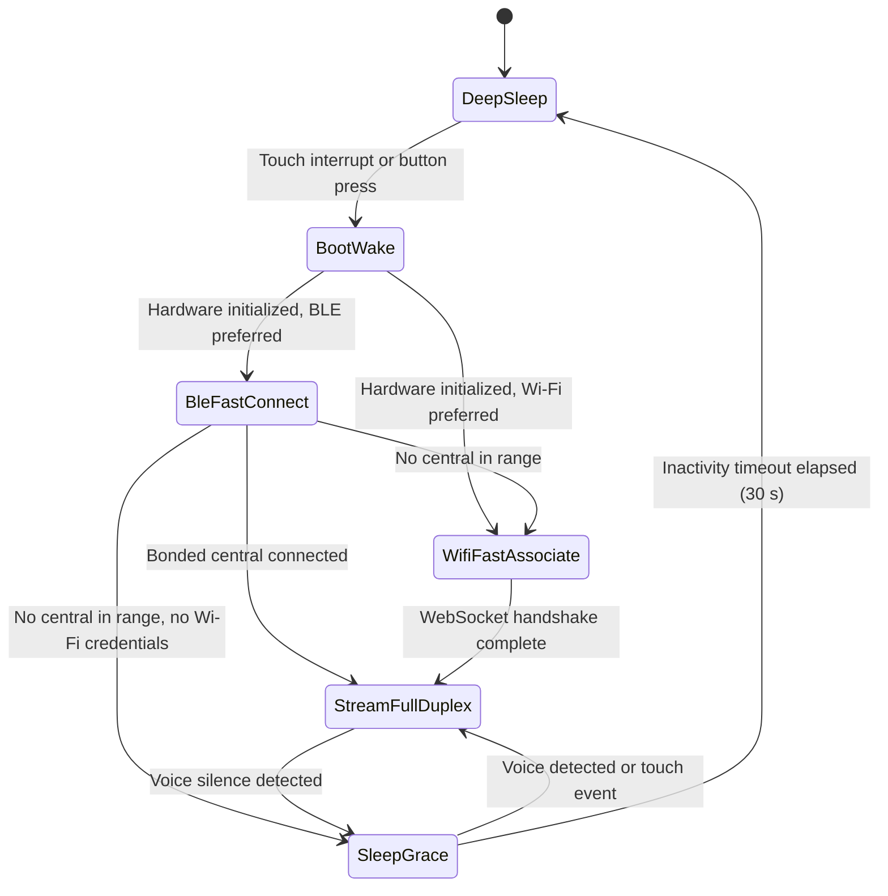

# BOHS-01 Architecture Specification

The Bulle Open Hardware Standard (BOHS-01) defines physical, electrical, and operational requirements for wearable artificial intelligence peripherals.

## Device classification

A BOHS-01 device operates strictly as a sensor and actuator peripheral. It does not run a general-purpose operating system, an application store, or a local large language model.

Traditional smart devices embed full operating systems like Android or Linux. That choice increases bill of materials costs, causes thermal throttling, drains batteries in hours, and requires fragile local application runtimes.

BOHS-01 splits the system cleanly:

1. The peripheral captures human intent through digital microphones and touch sensors.
2. The peripheral presents agent output through speakers, displays, and haptic actuators.
3. The server gateway executes all heavy computation: speech recognition, language reasoning, tool execution, and voice synthesis.

This division keeps the physical peripheral cheap, cool, reliable, and instantly responsive.

## Physical specification

### Form factor and geometry

A BOHS-01 device uses a circular disc geometry. The board is at most 38.0 mm across. The enclosure is at most 42.5 mm across and 14.0 mm thick, walls included.

This form factor enables versatile wearable attachments:

- Magnetic pendant on a neck chain or cord
- Spring-clip brooch for lapels and shirt pockets
- Wristband adapter cradle

### Enclosure and stack

The reference enclosure has three printed parts and four bought parts. `hardware/bodies/build.ts` builds all of them from the board kit (`bodies/kit/main/kit.json`), so the case follows the board when parts move. `fusible assembly` checks that every part fits.

Heights are in mm, measured from the board's mid-plane.

| Part | Body | From | To | Notes |
| :--- | :--- | :--- | :--- | :--- |
| Front bezel | `front_bezel` | 0.80 | 8.69 | Window of 32.4 mm over the active area. Two screw bosses on the board holes. |
| Lens | `lens` | 7.29 | 8.09 | Clear disc, 35.0 x 0.8 mm. The bezel lip holds it from the front. |
| LCD | `lcd` | 5.69 | 7.19 | GC9A01 1.28" panel (ZJY128R-IG01): 35.6 mm frame, 32.4 mm active area, 1.5 mm thick, FPC ledge toward J_LCD. |
| Board | `main` | -0.80 | 0.80 | 38 mm, 4 layers. |
| Battery | `battery` | -6.80 | -2.80 | 402020 cell. 0.5 mm swell room on every face. It stays 2 mm below the board, clear of the through-hole pin tails. |
| Speaker | `speaker` | -7.00 | -4.50 | Face down over a grille of 24 holes, 1 mm each. |
| LRA | `lra` | -7.30 | -4.60 | 0827 coin motor, glued to the floor. |
| Back shell | `back_shell` | -8.30 | 1.80 | Cup with pockets, mic port, USB-C opening, lead channel and lanyard lug. |

The outer diameter is 42.4 mm. The v0.4 reference case is 17.0 mm thick, which is over the 14.0 mm limit. The next board revision brings it back under.

The board has a flat edge at y = -18.557 mm. The USB-C receptacle front face sits on that flat, so a plug seats fully and its overmold clears the board. The case opening leaves 0.3 mm around the overmold.

#### Next revision

Three board changes bring the same case script under 14 mm:

1. Replace `J_BAT` (JST PH, 4.75 mm above the board) with a surface-mount connector no taller than the USB-C receptacle, or with two solder pads. The LCD then drops by 2.7 mm.
2. Replace the through-hole headers `J_SPK` and `J_HAP` and the through-hole button `SW_BOOT` with surface-mount parts. Their pin tails force a 2 mm gap under the board. Without them, the floor moves up by 1.5 mm.
3. Replace `J_LCD` (8-pin 2.54 mm header) with a 12-pin 0.5 mm FPC connector. The GC9A01 panel has a 12-pin FPC, and no off-the-shelf module lines up with the current header.

With all three, the case is 12.8 mm thick with the 402020 cell. A 502020 cell (5 mm, about 200 mAh) would also fit at 13.8 mm.

#### Battery choice

The battery sits under the board, beside the speaker, the LRA, the mic port and the two screw bosses.

| Cell | Size (mm) | Capacity | Fits | Why |
| :--- | :--- | :--- | :--- | :--- |
| 502035 | 35 x 20 x 5 | 350 mAh | No | With swell room it needs a 41.7 mm circle. The cavity is 40 mm. |
| 402030 | 30 x 20 x 4 | 300 mAh | No | It fits the circle, but not around the mic port and the two screw bosses, even without the speaker. |
| 402020 | 20 x 20 x 4 | 150 mAh | Yes | The largest common cell that leaves room for the speaker and the LRA. |

The 20 x 14 mm CDS-20148 speaker left room for a 16 x 16 mm cell at most. The 15 x 11 mm CMS-151125-18S-X8 speaker frees enough room for the 402020 cell.

#### Printing and assembly

1. Print `bodies/front_bezel.stl` face down and `bodies/back_shell.stl` floor down, in PLA or PETG, 0.12 mm layers. Cut or print `bodies/lens.stl` in clear acrylic or resin.
2. Stick a mesh sticker of 3.0 mm into the recess around the mic port, on the outside of the shell. Put a 0.2 mm gasket ring on top of the mic tube.
3. Glue the LRA into its ring, put the speaker face down on its seat, and drop the battery into its pocket. Run the battery leads up the channel at the J_BAT side.
4. Lay the board on the shell bosses, components up, with J_USB in the USB-C opening.
5. Glue the lens into the bezel recess, then stick the LCD panel behind it.
6. Close the bezel over the shell lip and drive two M2 x 10 mm self-tapping screws from the back.

The case fits the models, not yet the real parts. The LCD and battery sizes come from drawings, so one test print is needed before anyone calls the case final.

### Thermal constraints

The exterior case temperature must not exceed 40.0°C under continuous operational load in a 25.0°C ambient environment. This threshold complies with IEC 62368-1 standards for wearable consumer electronics in continuous contact with human skin.

The hardware achieves this thermal budget through three mechanisms:

- Hardware duty cycling of the radio transceiver
- Class-D audio amplification with efficiency exceeding 88 percent
- Offloading machine learning inference to the gateway server

### Bill of materials target

The total hardware bill of materials (BOM) target is under $25.00 USD at a production volume of 1,000 units.

| Subsystem | Component | Reference part | Target cost (1k qty) |
| :--- | :--- | :--- | :--- |
| Microcontroller | Dual-core Xtensa 32-bit LX7 MCU with Wi-Fi and BLE 5.0 | ESP32-S3R8 (QFN, 8 MB in-package PSRAM) | $2.85 |
| Audio Input | I2S digital MEMS microphone with 64 dB SNR | Knowles SPH0645LM4H-B / INMP441 | $0.95 |
| Audio Output | Mono 3.2W Class-D I2S audio amplifier | Maxim MAX98357AETE+ | $0.85 |
| Speaker Transducer | Micro speaker 8 Ohm 1W, 15 x 11 x 2.5 mm | Same Sky CMS-151125-18S-X8 | $1.60 |
| Display | 1.28-inch round IPS TFT LCD (240x240 SPI) | GC9A01 driver | $3.40 |
| Actuator | LRA / ERM miniature vibration motor with driver | TI DRV2605LDGSR + 0827 motor | $1.40 |
| Power Management | Single-cell Li-ion linear charger, 146 mA, Schottky load sharing | TP4056 (SOP-8) + 2x 1N5819WS | $0.65 |
| Voltage Regulation | Ultra-low quiescent current LDO 3.3V 500mA | TI TPS7A0533PDBVR | $0.35 |
| Battery Cell | Rechargeable Lithium Polymer cell 3.7V 150mAh | 402020 pouch cell (20 x 20 x 4 mm) | $1.80 |
| PCB | 4-layer FR4 high-density interconnect round board | 38mm circular board | $1.80 |
| Enclosure | Printed front bezel and back shell, clear lens | Two M2 screws, 0.4 mm clearance lip | $2.50 |
| Passives and Connectors | USB-C receptacle, ESD diodes, resistors, capacitors | Standard SMT passives | $1.60 |
| Assembly and Testing | Surface mount assembly and automated flashing | Turnkey PCBA | $4.20 |
| **Total** | | | **$23.95** |

### Charging and power path

The reference hardware charges its cell with a TP4056 linear charger in a SOP-8 package.

- `R_PROG` is 8.2 kOhm. The TP4056 sets charge current as 1200 / R_PROG, so the cell charges at about 146 mA.
- 146 mA is about 0.97C for the 150 mAh cell. A full charge takes about 1.5 hours.
- Two 1N5819WS Schottky diodes share the load. `D_SYS` runs from `VBUS` to `VSYS`. `D_PATH` runs from `VBAT` to `VSYS`. When USB-C is present, `VBUS` feeds `VSYS` and the charger fills the cell. When USB-C is absent, the battery feeds `VSYS`.
- A TPS7A0533 LDO produces the 3.3 V rail from `VSYS`.

### Battery life specifications

The reference hardware runs on a single-cell 150 mAh lithium polymer battery (0.555 Wh nominal energy).

Every figure in this table is a design target. None of them is a measurement yet.

| Operating mode | Average current draw (target) | Duration (target) |
| :--- | :--- | :--- |
| Deep sleep | 18 uA | > 7.7 days (> 185 hours) |
| Active voice streaming, BLE 5.0 2M PHY relay | 14 mA | > 10.3 hours |
| Active voice streaming, Wi-Fi WSS direct | 42 mA | > 3.5 hours |
| Burst tool interaction | 68 mA (display, haptics, speaker active) | > 2.2 hours |
| Mixed daily usage profile | 2 hours active stream on Wi-Fi, 22 hours deep sleep | 1.6 days between charges |

## Transports

A BOHS-01 device carries the same `bohs.v1` frames over three transports. The frame format does not change between them. Only the outer framing changes. [BOHS-01-WIRE.md](BOHS-01-WIRE.md) defines both.

| Transport | Link | Peer | Use |
| :--- | :--- | :--- | :--- |
| `BleRelay` | BLE 5.0 GATT, 2M PHY, service `b0010000-f4c1-4e00-b001-000000000001` | Bulle mobile or desktop app, which relays frames to the gateway | Default when a bonded phone or laptop is in range. Also the only pairing path. |
| `WifiDirect` | Wi-Fi WSS to `/api/hardware/ws` | Bulle gateway | Fallback when no bonded central is in range and Wi-Fi credentials are provisioned. |
| `UsbSerial` | USB-C CDC ACM on `GPIO19` (D-) and `GPIO20` (D+) | Bulle desktop or CLI on the host computer | Desk mode and debugging while plugged in. |

### Transport selection

1. When USB-C is connected to a host that opens the CDC port, the device uses `UsbSerial`.
2. Otherwise, a provisioned device with `prefer_ble = true` tries `BleRelay` first.
3. If no bonded central connects within the BLE connect window, and the device holds Wi-Fi credentials, the device falls back to `WifiDirect`.
4. If the BLE link drops during a session, the device runs step 3 again.
5. A device with `prefer_ble = false` tries `WifiDirect` first and uses `BleRelay` when Wi-Fi association fails.

### Pairing

A new device starts in the `unclaimed` state and advertises the BOHS-01 service. The user pairs it from the Bulle app:

1. The app bonds with the device over BLE LE Secure Connections.
2. The app sends `prov.identify`. The device pulses its haptic motor, draws a pairing ring on the LCD, and opens a 60 second window.
3. The user taps the capacitive pad (`GPIO7`, net `TOUCH_WAKE`) inside that window. The device moves to `authorized`.
4. The app claims the device with Bulle and receives a `bohs_tok_` device token.
5. The app writes `prov.configure` with the gateway URL, the token, and optional Wi-Fi credentials. The device stores them in NVS and moves to `provisioned`.

If the window ends before step 5, a new device returns to `unclaimed`. [BOHS-01-WIRE.md](BOHS-01-WIRE.md) defines the provisioning messages and their security rules. [BOHS-01-GATEWAY.md](BOHS-01-GATEWAY.md) defines the claim endpoint.

## Power states and transitions

The device firmware implements six discrete power states to maximize battery longevity.

### State descriptions

#### Deep sleep

All main power rails shut down except the ultra-low-power (ULP) coprocessor and the real-time clock (RTC) controller. RTC memory keeps the cached Wi-Fi BSSID and radio channel. NVS flash keeps the provisioning config (gateway URL, device token, Wi-Fi credentials, transport preference) and the BLE bond keys.

- Current consumption: 18 uA typical, 25 uA maximum (target).
- Active peripherals: RTC timer, capacitive touch sensing pad on `GPIO7`.
- Clocks: 32.768 kHz RTC crystal oscillator.

#### Boot and wake

A capacitive touch event or physical button press triggers an RTC interrupt. The internal DC-DC converter powers up the high-speed CPU cores.

- Current consumption: 22 mA.
- Duration: Under 50 ms from trigger signal to firmware entry point (target).
- Tasks: Initialize I2S audio bus, power peripheral regulators, load cached connection state from RTC memory and NVS.

#### BLE fast connect

The device starts advertising the BOHS-01 service to its bonded central. The central reconnects and resumes the encrypted link with the stored bond keys.

- Advertising start: Under 6 ms after firmware entry (target).
- Exit criteria: A bonded central connects and enables notifications, which moves the device to full-duplex stream. If no central connects within the BLE connect window, the device moves to Wi-Fi fast associate when it holds Wi-Fi credentials, or back to sleep grace when it does not.

#### Wi-Fi fast associate

The radio transceiver connects directly to the cached wireless access point using pre-negotiated parameters. The client skips full channel scanning and reuses its DHCP lease.

- Current consumption: 110 mA average during radio transmission.
- Duration: Under 800 ms from cold wake to established TCP socket (target).
- Tasks: Direct frame association to target BSSID, TLS session resumption, WebSocket upgrade request.

#### Full-duplex stream

The primary operational state. The microphone continuously feeds 16 kHz PCM16 audio frames upstream. The speaker plays synthesized speech downstream. The display shows real-time avatar expressions.

- Current consumption (target): 14 mA average on BLE relay, 42 mA average on Wi-Fi direct.
- Active peripherals: Dual-core CPU running at 160 MHz, BLE or Wi-Fi radio, I2S microphone, I2S amplifier, SPI display.
- Tasks: PCM16 framing, `bohs.v1` multiplexing, transport framing, Reverse MCP tool execution.

#### Sleep grace

When voice activity detection signals end of speech and no downstream audio plays, the device drops into sleep grace. The display dims and the audio power amplifier turns off.

- Current consumption: 14 mA.
- Duration: 30 seconds inactivity window.
- Purpose: Prevents costly radio reconnection cycles during multi-turn human conversation.
- Exit criteria: Voice resumption immediately restores full-duplex stream; timer expiration triggers entry into deep sleep.
